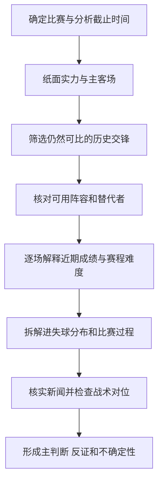

# 比赛分析逻辑与赛前检查清单

这段视频的核心方法是：先建立球队实力的初步判断，再把伤病、近期赛程、对手当时的状态和进失球分布放回具体背景，检查表面上的强弱差距是否被夸大。最值得学习的是每一步的解释过程：一份好成绩可能含有有利赛程的帮助，一份差成绩也可能反映连续遇到强敌。

来源：[用户提供的比赛分析视频](</Users/xuao/Documents/2025 找工作/AI Projects/football-oracle-agent/5281222a46396516f3a42d088eea87ac.mp4>)，画面账号为“@博扬足球”，时长约 3 分 44 秒。以下按全段可见字幕和相关画面整理，时间为约数。案例中的赛果、排名、身价和伤病是视频材料中的陈述，未独立核实为现实赛事事实。视频主要讲快速了解球队，没有建立完整的胜率模型。

## 视频的七步分析顺序

| 步骤 | 视频位置 | 看什么 | 为什么看 | 应形成的判断 |
| --- | --- | --- | --- | --- |
| 1 纸面实力 | 00:05–00:22 | 身价、排名、长期联赛层级、升班马身份、过去赛季表现 | 先了解两队通常处在什么水平 | 哪队通常更强，差距大致多大；暂不据此定胜负 |
| 2 主客场 | 00:22–00:25 | 本场谁主场、谁客场 | 比赛环境影响发挥 | 是否需要修正初步强弱判断；视频没有展开具体指标 |
| 3 交锋历史 | 00:25–00:50 | 历史交手结果，以及这些比赛发生的时间 | 过旧交锋可能不再代表当前球队 | 先判断历史是否可比，再使用结果 |
| 4 伤病情况 | 00:50–01:28 | 何时受伤、本赛季出场与首发、位置、是否主力 | 同样缺三个人，实际影响可能完全不同 | 缺阵影响哪条线，是否改变目前可用阵容 |
| 5 近期状态 | 01:28–02:24 | 同赛事成绩、逐场对手、对手当时状态、换帅、近期止颓 | 胜平负受到赛程难度和交手时机影响 | 成绩有没有高估或低估真实表现 |
| 6 进失球 | 02:24–02:55 | 总进失球、每场分布、失球来自谁、是否集中在一场 | 相同总失球可以对应不同的防守问题 | 是持续失守、单场重挫，还是对强敌的合理受压 |
| 7 近期新闻 | 02:55–03:05 | 经营、更衣室、球队氛围等 | 有些变化不能从比分直接读出 | 作为需进一步确认的背景，视频承认这部分难以量化 |

视频在 03:14–03:28 另行说明：战术细节、教练选择等复杂问题需要具体比赛具体拆解，并未在本段形成系统的战术分析方法。

## 各步骤背后的推理

### 纸面实力用于建立起点

身价和排名提供一个快速起点，但球队本场能发挥多少，还取决于可用球员和对阵条件。视频先指出纽卡斯尔在身价和长期成绩上占优，随后逐步检查这份优势是否仍然成立。

可复用的问题是：**如果暂时只看球队背景，我会作出什么判断？后面的证据能支持或推翻多少？** 这样可以把初印象与后续修正分开，避免看见排名就提前下结论。

### 交锋历史要先检查可比性

视频用很早的交锋记录说明：历史上一方几乎全胜，也可能对当前比赛帮助很小。其经验范围是俱乐部约看近两个赛季，国家队约看一个四年大赛周期。这是作者的筛选经验，不是经过验证的统一有效期。

整理后的使用原则是：日期只是第一道筛选，还要检查教练、核心阵容、实力层级和对阵风格是否延续。近期交锋同样不能保证下一场继续复制结果。

### 伤病影响取决于角色和当前基线

视频没有简单比较伤员人数，而是逐个看本赛季出场、首发及位置。其案例推理为：考文垂的缺阵主要影响后防，纽卡斯尔的缺阵分布在前、中、后三线，因此后者的纸面优势需要打折。

这一步真正有用的逻辑是：**缺谁 → 平时承担什么任务 → 现在由谁接替 → 哪种能力可能下降。** 前两项来自视频，替代者与具体能力的检查是补充完善。

还应区分两个问题：

- 相比最近几场，今天是否新增了缺阵影响？
- 相比完整阵容，球队是否仍然存在长期能力缺口？

长期伤员可能已经包含在近期表现中，不宜重复扣减；但这不代表他的长期缺阵没有影响。

### 近期成绩要逐场解释

视频最重要的一步是把近期胜平负拆开。对纽卡斯尔，作者认为部分好结果来自遇到状态不佳的对手；对考文垂，作者认为连续输球受到强敌密集赛程影响，并注意到最近一场客场获胜。

这里检查的是三个不同问题：

1. 对手在交手当时有多强？不能只使用对手名气。
2. 本队实际表现与比分是否一致？视频主要依据结果解释，这一项仍需比赛内容补证。
3. 最近一场是否提供了变化信号？一场止颓值得关注，但不足以单独确认已经反弹。

因此，“击败强队”不自动等于状态优秀，“输给强队”也不自动等于表现合格。分析必须同时保留支持与反对当前判断的比赛。

### 进失球要看分布和对手

视频中的考文垂被描述为五轮进 1 球、失 10 球，其中 5 球集中在对布莱顿的一场；作者还用零封森林和对曼城只失 1 球，解释防守表现没有总数看起来那么差。纽卡斯尔被描述为五轮进 9 球、失 9 球，且被利兹联打入 4 球，作者据此质疑其防守稳定性。

可学习的是分布意识：**连续五场每场失 2 球，与一场失 5 球、其他场次失球较少，暴露的问题可能不同。** 但集中失球的比赛必须保留，并继续判断是偶发事件还是可重复出现的弱点。

视频案例里的“丢得合理”“成绩有水分”仍是解释性判断。若要确认，应补查机会质量、红牌、点球、首发变化和具体攻防过程。

## 视频案例如何收束

下表还原作者的推理，不把其案例数据视为已经独立核实的比赛事实。

| 观察层 | 对纽卡斯尔的解释 | 对考文垂的解释 |
| --- | --- | --- |
| 纸面实力 | 身价、长期成绩更好 | 升班马，排名和开局成绩较差 |
| 可用阵容 | 主力及半主力缺阵涉及三条线 | 作者认为主要影响中后卫位置 |
| 近期成绩 | 好结果可能获得对手低迷时机的帮助 | 差结果可能受到连续强敌赛程影响 |
| 进失球分布 | 能进球，但持续失球和对利兹的大比分失利值得注意 | 总失球偏多，但一场占一半，部分场次防守有亮点 |
| 最近变化 | 作者认为表现起伏较大 | 最近客场获胜被视为止颓信号 |

作者的收束是：**比赛可能比纸面实力展示的更胶着。** 这并不等于考文垂必胜，也没有提供足以推出具体胜率或比分的计算过程。

## 学习时需要修正的简化

以下是对方法的补充完善，不是视频原话或已经验证的统计规律。

| 视频中的简化 | 更稳妥的使用方式 |
| --- | --- |
| 一个月前受伤的球员可以不看 | 区分长期缺阵基线与本场新增影响；仍检查长期能力缺口和复出情况 |
| 本赛季没出场或只出场一次，所以没有影响 | 出场少可能正是伤病造成的；结合健康时期角色、替代者和球队计划判断 |
| 近两季交锋可以强烈指向结果 | 仍检查样本量、阵容与教练变化；交锋只是部分证据 |
| 输给强敌、失球集中，因此差成绩可以解释 | 解释不能代替表现证据；也要检查是否长期创造不了机会或反复暴露同一弱点 |
| 赢了状态差的对手，因此成绩有水分 | 先用可核实的当时信息定义对手状态，再检查本队表现，避免事后挑理由 |
| 连败后的胜利意味着止颓 | 保留为初步信号，确认比赛过程和后续延续性 |
| 更衣室或心理因素能解释表现 | 区分官方声明、可靠报道与猜测；不能从输球直接推断球员心理状况 |

另一个需要补上的环节是**双方风格是否相克**。例如，主队能否处理高压逼抢，客队能否打穿低位防守，边路、定位球和攻防转换是否存在具体弱点。视频承认战术复杂，但没有展开这些机制。

## 可复用的赛前流程



“分析截止时间”“替代者”“比赛过程”“战术对位”是补充环节。所有用于赛前判断的信息，都应在截止时间前已经可知，避免用后来的表现或新闻解释之前的预测。

### 赛前检查清单

- [ ] 确认赛事、对阵、主客场、开球时间及本次分析截止时间。
- [ ] 写出仅凭球队背景形成的初步强弱判断。
- [ ] 检查交锋记录的时间和可比性；不适用时说明原因。
- [ ] 按球员角色核实伤停、停赛、预计或确认首发，区分长期与新增影响。
- [ ] 检查替代者能否承担相同任务，以及是否整条线同时受损。
- [ ] 使用明确的近期样本范围，逐场记录对手在交手当时的状态。
- [ ] 保留所有场次，检查进失球是否持续、集中或受特殊事件影响。
- [ ] 用比赛内容检验对结果的解释；有数据时可补充预期进球、机会质量等。
- [ ] 核实新闻，并检查与本场有关的具体战术对位。
- [ ] 同时列出支持证据、反对证据和缺失信息，再形成比赛走势判断。

### 单场分析模板

```text
比赛与赛事：
主客场与开球时间：
分析截止时间：

1. 初步实力判断：
2. 主客场修正：
3. 可使用的交锋证据及可比性：
4. 阵容影响：长期基线 / 新增缺阵 / 替代者 / 首发确定性
5. 近期成绩解释：样本范围 / 对手当时状态 / 表现与结果
6. 攻防表现：逐场进失球 / 集中失球 / 特殊事件 / 机会质量
7. 新闻与战术：已核实信息 / 具体对位 / 待确认信息

主判断：相比初步判断，差距扩大、缩小，还是证据不足？
最可能的比赛走势及理由：
支持证据：
最强反证：
哪些条件出现会改变判断：
尚未确认的信息：
```

这套流程可以生成有依据的定性分析。要进一步输出概率，需要另行建立并验证模型，不能直接把这些判断兑换成任意百分比。

## 在 Football Oracle 中的用途

这份方法适合补充项目已有的 [Match Intelligence V1](</Users/xuao/Documents/2025 找工作/AI Projects/football-oracle-agent/docs/PREMIER_LEAGUE_MATCH_INTELLIGENCE_SKILL_V1.md>)，尤其是近期赛程解释、交锋可比性和进失球分布的检查。

按项目现有边界，它可以提供研究层的支持、质疑或中性判断。球员与战术信息的数值转换仍未得到验证，不能据此改写冻结的生产概率。本文整理方法与检查清单，未修改预测模型或生产规则。
